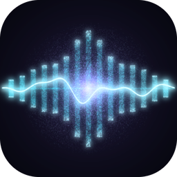

<p align="center">
  
</p>

# Hermes Vox

Hermes Vox is an Android app for talking by voice to Hermes — the agent you run yourself. You open
the voice line and speak; the phone hears you, sends the words to the agent, speaks the reply and
shows what the agent is doing.

The app is a client. It has no account, no hosted service and no second brain. Everything that
must be instant — hearing, turn-taking, speech, the figure on screen — runs on the phone.
Everything that must be true — reasoning, tools, memory, identity — stays in the Hermes instance
you run.

## The words this document uses

- **The gateway** is the Hermes API server you run. You reach it at a URL you own, with the
  `API_SERVER_KEY` it was started with.
- **The agent**, or **the mind**, is the Hermes instance on that gateway. It owns the reasoning,
  tools, long-term memory, skills and identity. Vox never invents a second agent or a persona
  over it.
- **A call** is the one kind of conversation the app offers: an open, hands-free line where the
  microphone stays live under voice-activity detection, and you interrupt by speaking.
- **A turn** is one exchange on that line: your words go to the agent, and the reply comes back.
- **The being** is the GPU-drawn figure on screen. It takes a shape for resting, listening,
  thinking, speaking and for each kind of tool the agent runs.
- **Presence** is an optional, unfinished layer that gives the being a small on-device voice — the
  *soul*. It speaks the opening beat of a turn — two to six words spoken while the mind starts to
  answer — in the agent's style. It is not a second agent, does no reasoning and calls no tools.
- **A profile** is one saved connection: the gateway address, its key, the request's model value
  (usually `hermes-agent`), and the voice and look that belong to that agent.
- **A session** is one conversation as the host files it. The `/sessions` command lists the
  host's sessions and lets you pick one up.
- **Phone tools** is the optional surface that lets the mind act on the phone — timers, alarms,
  Do Not Disturb and volume, media keys, the clipboard, granted folders, calendar, contacts,
  notifications and app handoffs — through one tool on the Model Context Protocol (MCP), the
  protocol the gateway uses to reach tools.
- **An approval** is the gateway's question before a consequential action. The phone shows what
  is being approved, the choices the gateway offered, and answers once. A timeout is a no.
- **The alpha gate** is one switch in Settings, off on a fresh install. It opens the unfinished
  feature sets, each selected on its own. The sets and their dependencies are described in
  [docs/ARCHITECTURE.md](docs/ARCHITECTURE.md).

## What you need

- An Android phone running Android 7.0 (API 24) or later. The release APK contains the
  `arm64-v8a` and `armeabi-v7a` libraries.
- A Hermes gateway you operate, and its `API_SERVER_KEY`. The app verifies the connection with a
  real request to `GET /v1/models`; a wrong address or key fails before anything is saved.
- A network route from the phone to the gateway. HTTPS is required except for a tailnet
  MagicDNS name (`*.ts.net`) while Tailscale is connected. A tailnet is a private network run by
  a mesh VPN; Tailscale is the one whose addresses the app's own servers recognise and bind to.
  A VPN or tailnet you control is the intended setup.
- About 294 MB of on-device models: Silero VAD, Supertonic and Whisper base.en. The app
  downloads them in **Settings → Voice models**.
- For Presence: the optional Gemma 4 E2B model (about 2.6 GB) and a phone with 8 GB of memory.
  First run checks the phone and says so when it falls short.
- For phone tools and file offers: Tailscale on the phone, because the app's servers bind only
  to the tailnet address.

## Install

**Obtainium.** Add `https://github.com/chezgoulet/hermes-vox` as a GitHub source, or use the
[Obtainium link](https://apps.obtainium.imranr.dev/redirect?r=obtainium://add/https://github.com/chezgoulet/hermes-vox).
Obtainium installs the signed APK from each GitHub release and keeps it updated.

**APK.** Download `hermes-vox-<version>.apk` from the
[latest release](https://github.com/chezgoulet/hermes-vox/releases/latest) and install it,
allowing installs from that source.

**F-Droid.** Hermes Vox is not listed on F-Droid. The draft recipe and the source-built speech
runtime it needs are described in [docs/FDROID.md](docs/FDROID.md).

**Build from source.** Install JDK 17 and the Android SDK, export `JAVA_HOME` and
`ANDROID_HOME`, then run the one-command gate:

```bash
bash scripts/gate.sh
adb install -r android/app/build/outputs/apk/debug/hermes-vox-*.apk
```

The gate fetches the pinned speech runtime, builds the APK and runs every unit test. What a
change needs to be reviewable is in [CONTRIBUTING.md](CONTRIBUTING.md); the release process is
in [docs/RELEASE-PROCESS.md](docs/RELEASE-PROCESS.md).

## Connect it to a gateway

1. On first launch, enter the gateway **endpoint** and its **`API_SERVER_KEY`**. Both are
   required. The endpoint may carry a trailing slash; the app trims it.
2. Tap **Connect & verify**. The app asks the gateway for `/v1/models` and adopts the agent name
   the host answers with.
3. Install the three required models in **Settings → Voice models**. Downloads run in the
   background, resume after network loss, and are sha256-checked before unpacking.
4. Optional: accept the one-time offer to **Teach your agent this app**. It asks the agent to
   install the app's own description (`hermes-vox-app`) on your gateway, so the agent can answer
   "where is that setting?" about Vox. Nothing is installed unless you choose it; the same
   action lives in **Settings → Entity & Connection → Teach your agent this app**. See
   [docs/APP-SKILL.md](docs/APP-SKILL.md).
5. Tap the call button and talk.

On a gateway shared by several people, **Settings → Entity & Connection → Entity scope** sets
`X-Hermes-Session-Key`, a stable per-person identifier from which the gateway derives the
long-term-memory scope. Blank means not declared. It is not a credential and is stored in plain
preferences; the API key is the secret.

The endpoint may address a profile directly (`https://host/p/<name>`). Profiles are listed and
switched from the host; they are not created in the app.

## The call

The microphone feeds Silero VAD. When a finished utterance exists, it is recognised on the
phone — Whisper base.en by default, with smaller, larger, Parakeet and multilingual Whisper
models available — validated against the recogniser's known hallucinations, and sent to the
gateway as text. The gateway's reply streams back; the phone speaks it in short chunks as it
arrives and scrolls the words in step with what has actually been spoken. The dim "heard" line
shows the words that were sent.

You can talk over a reply. Barge-in cuts the audio, cancels the turn — and on the default
`/v1/runs` route also stops the run on the gateway — and the interrupting words become the next
turn. The agent can stop and ask for approval before a consequential command; the phone shows
the command, the reason and the gateway's own choices, and a timeout answers no.

The call cannot reason, use a tool or remember anything on the phone. It cannot carry an
approval when the gateway falls back to `/v1/responses`: that route does not deliver approval
requests. It is half-duplex — it listens or speaks, with barge-in, not both at once.

## The phone tool surface

When **Phone tools** is enabled, the app runs a small MCP server on the tailnet address. The
mind calls one tool, `phone`, with an action; the phone validates the action against the grants
you set, performs it, and returns a result saying what happened. Thirteen capability groups are
defined. Every group is **Off**, **Ask** or **Allow**, and every group starts Off. Off means the
action is absent from the tool's schema; Ask raises the phone's own card and runs only after you
answer; Allow runs without a card. The server listens only while a call is live or during a
setup attempt, and only on the tailnet.

Presence may read what the phone is doing; it cannot change it. The phone does not parse your
spoken words to decide an action — every voice turn goes to the mind, and the mind decides
whether to call the tool.

The phone tools cannot reach a phone that is not on the tailnet, cannot act while no call or
setup attempt is open, and cannot act in a group you have left Off. An action that the catalogue
declares but the phone does not implement is never advertised. [docs/MCP-PHONE.md](docs/MCP-PHONE.md)
covers setup and the wire; [docs/MCP-SURFACE.md](docs/MCP-SURFACE.md) is the action-by-action
contract.

## Presence

Presence is the optional layer behind the alpha gate. When it is enabled and its model is
installed, Gemma 4 E2B runs on the phone (GPU first, CPU fallback), reads a read-only mirror of
the agent's `VOX.md` voice file, and speaks two to six words at the start of a turn while the
mind works. It also reads the caller's tone from the last few seconds of on-device audio. Every
turn still goes to the mind; the soul offers the beat and never the answer. The agent writes
`VOX.md` on the gateway, and the phone never writes identity back.

Presence cannot answer a question, call a tool or change the phone. It needs the 2.6 GB model
and a phone with 8 GB of memory; it holds about 3 GB while a call is live. It is unfinished:
the alpha gate is off by default, and switching it off stops everything Presence owns.

## Profiles and sessions

A profile is the whole connection plus the presentation that belongs to it: address, key, model
value, voice and look. The list comes from the host. Switching profiles writes the chosen
connection, rebuilds the session and starts a fresh conversation; a live call ends.

`/sessions` lists the conversations the host already holds and adopts one by setting the
conversation id (`session_id`) that the next turn is filed under. The transcript stays the host's;
the app keeps no conversation history on disk. Profiles are a picker, not an editor: nothing in
the app creates or changes one on the host.

## What it sends, and what stays on the phone

- **To the gateway:** the text of each turn, the per-request voice instructions, the declared
  entity scope, approval answers, and the reads behind profiles, sessions and the app-skill
  install. The bearer key travels only to the gateway you configured.
- **On the tailnet:** the phone-tools MCP server and, only after you confirm a share, a one-time
  file offer. The file is staged, hashed, capped at 100 MB, expires after five minutes, and is
  served once; text under 8,000 bytes travels inline instead. Nothing is sent until you press
  **SEND**.
- **From model hosts:** the model files you choose to download, from the k2-fsa sherpa-onnx
  releases and Hugging Face.
- **On the phone:** microphone audio is transcribed on the device by default; Presence's tone
  audio goes only to the on-device model. The gateway key is encrypted with a key in the Android
  Keystore, and app backups are disabled. If the Keystore refuses to encrypt on a device, the
  value is kept locally in plain text, the failure is logged and the next start retries.
- **Logs** are local. Transcript logging is off by default.

The app writes on the phone: preferences, the encrypted key, downloaded model files, local logs,
the read-only `VOX.md` mirror when Presence runs, and a staged copy of a file while an offer is
open — deleted when the offer ends. The app itself writes nothing on the gateway. The agent may
write there as part of a flow you start — install the app skill, add the phone-tools entry, or
author `VOX.md`. Phone actions change the phone only through the granted tool.

The one way microphone audio leaves the phone is the optional remote recognition endpoint: if
you select it and supply a URL, the audio for a turn is sent to that URL. No other path uploads
microphone audio; a file you choose to share follows the share path above.

See [PRIVACY.md](PRIVACY.md) for the full policy and [SECURITY.md](SECURITY.md) for the threat
model and how to report a vulnerability.

## What it cannot do

- It cannot work without a gateway you run, and it cannot install Hermes or start a gateway for
  you.
- It cannot reason, call tools or keep long-term memory on the phone; every voice turn goes to
  the mind.
- It cannot listen and speak at the same time. Barge-in is the interruption path.
- It cannot carry approvals on the `/v1/responses` fallback route.
- It needs the Presence model (2.6 GB); on a phone below 8 GB of memory it may fail to load, and
  Presence cannot answer or act.
- It cannot use phone tools without the alpha set, a one-time setup with the agent and a grant
  for the group; the listener is down when no call or setup attempt is open.
- It cannot create or edit profiles; the host owns them.
- It cannot be installed from F-Droid yet.
- It cannot recognise a language the installed recognition model does not cover. The default is
  English; multilingual Whisper models are in **Settings → Voice models**.

## Where this is going

Six milestones, in this order, each defined by something you could say after updating. No dates: a
release ships when its gate is green.

1. **The gate** — the app's own latency measured, good runs recorded instead of only failures, and the
   documentation brought back in line with the code.
2. **Promote what already works** — approvals, the digital assistant, phone tools, turn-taking,
   continuous listening and Presence. Most of this is built and switched off; it leaves the gate as it
   proves out, not on a schedule.
3. **Small builds that stop the app misleading you** — a refused key named as a refused key, a
   question asked mid-run actually shown, the last few turns kept so silence is not mistaken for an
   answer.
4. **How a reply is spoken** — phrasing that does not reset every two seconds.
5. **Interruption that keeps the work** — it can be interrupted, and what it was doing survives.
6. **Localisation readiness** — every string in a resource, verified with a pseudo-locale, so the next
   release can be translation rather than archaeology.

The full plan, with effort classes and exit criteria: [`ROADMAP.md`](ROADMAP.md). The reasoning behind
it, including the two independent reviews that reshaped it: [`docs/PLAN-MVP.md`](docs/PLAN-MVP.md) and
[`docs/SECOND-OPINIONS-2026-11-13.md`](docs/SECOND-OPINIONS-2026-11-13.md).

## Where the rest of the documentation is

What is being built next, and how to pick it up: [ROADMAP.md](ROADMAP.md) is the plan of record, and
[SPRINT-PLAN.md](SPRINT-PLAN.md) is the sequence the next work follows.

[docs/INDEX.md](docs/INDEX.md) is the map: every living document with what it answers, and the
historical records kept separately. Start with [docs/ARCHITECTURE.md](docs/ARCHITECTURE.md) for
how the pieces fit together and where the phone/host boundary is. Feature documents:
[docs/PRESENCE.md](docs/PRESENCE.md), [docs/MCP-PHONE.md](docs/MCP-PHONE.md),
[docs/MCP-SURFACE.md](docs/MCP-SURFACE.md), [docs/RUNS-ROUTE.md](docs/RUNS-ROUTE.md),
[docs/APP-SKILL.md](docs/APP-SKILL.md), [docs/MODELS-SCREEN.md](docs/MODELS-SCREEN.md).

## License and credits

[GPL-3.0](LICENSE). The on-device speech runtime statically links espeak-ng, which is GPL-3.0;
[NOTICE](NOTICE) lists the components and the source offer. On-device models are downloaded
separately and keep their own terms.

Hermes Vox is built on [Hermes Agent](https://hermes-agent.nousresearch.com) by
[Nous Research](https://nousresearch.com), and on [sherpa-onnx](https://github.com/k2-fsa/sherpa-onnx)
(k2-fsa), [Supertonic](https://huggingface.co/Supertone/supertonic-2) (Supertone), Whisper
(OpenAI), Parakeet-TDT (NVIDIA), Silero VAD, Piper, Gemma and LiteRT-LM (Google), and the
Rajdhani typeface (Indian Type Foundry, OFL).

Hermes Vox is an independent community project. It is not affiliated with or endorsed by Nous
Research.
