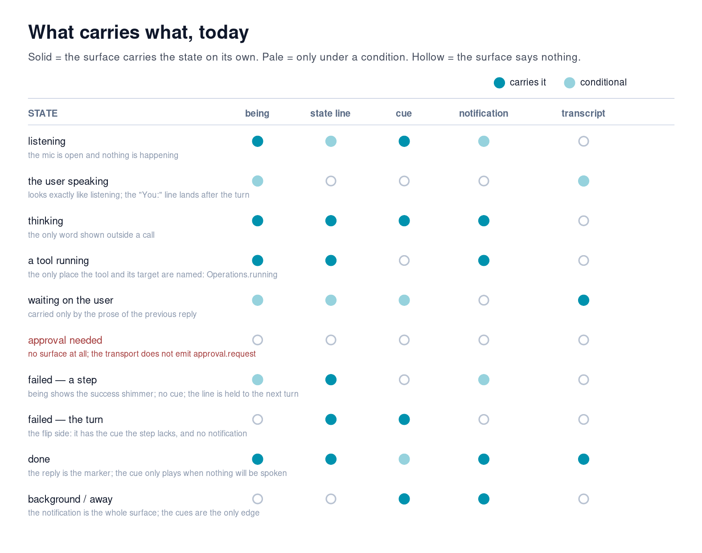
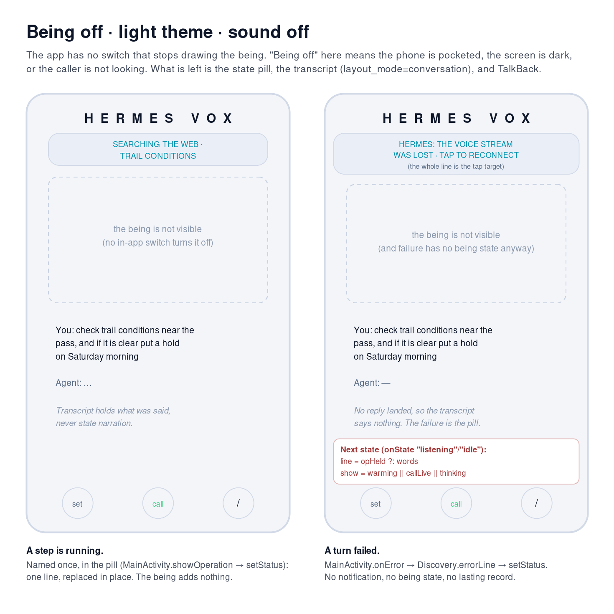
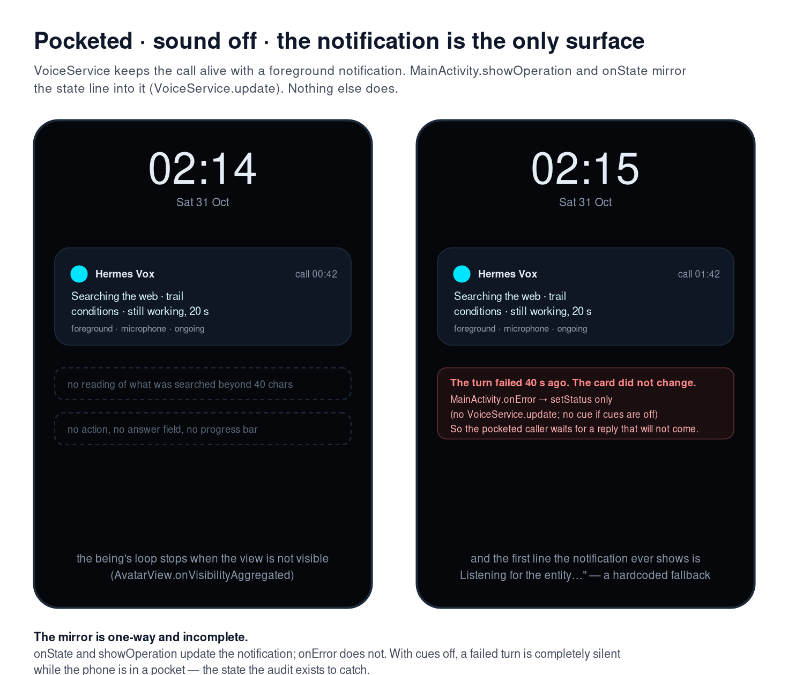
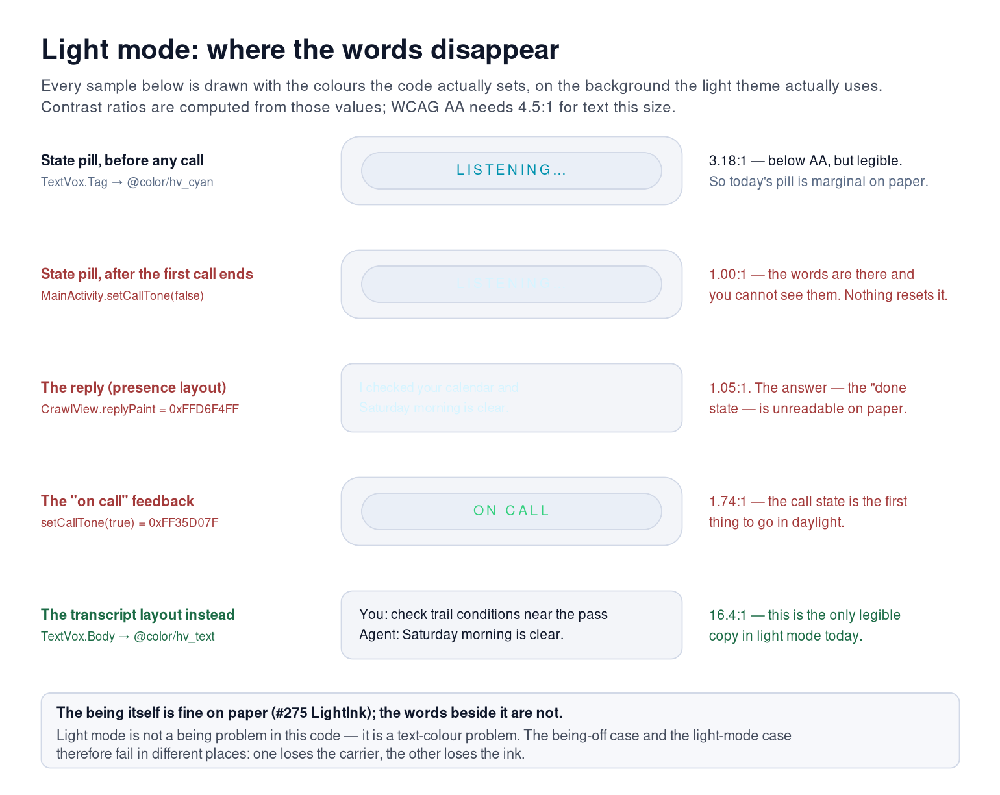
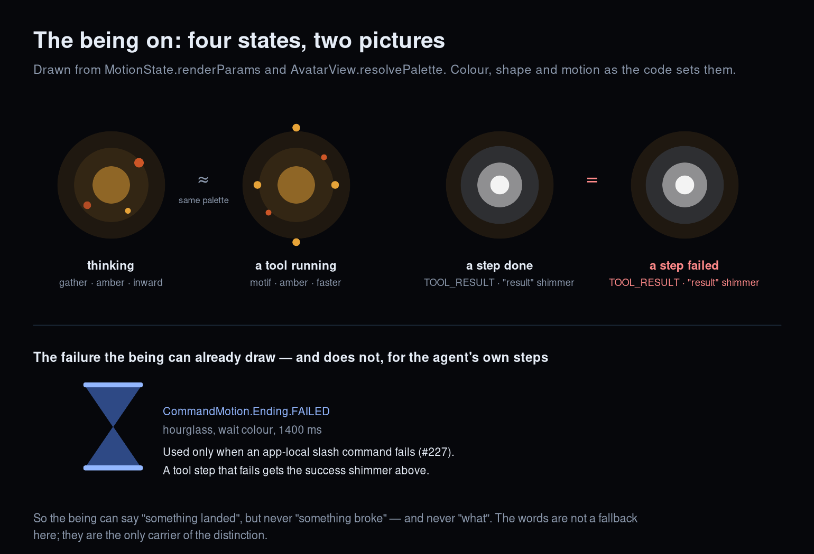

# State audit — which surface carries which state (#280)

Set 2026-10-31, read from `testing` at `6aea36d`. This is an audit and a design document: it changes
no production behaviour. It replaces the 2026-10-21 draft of this file and keeps its one decision —
**one line of words, not a panel** — extending it to the two configurations the draft did not test
(being off, light mode), to the states that have no surface, and to what #281/#282/#284 need from it.

The test for every row is the issue's: *it must hold with the being off, with sound off, and in light
mode.* A row that only works in one configuration is recorded as a finding, not quietly filled.

All symbols are in `android/app/src/main/java/com/hermesvox/` unless a path is given. Rows I could
not substantiate from the code say **unverified**.

## 1. What "off" and "light" actually mean here

| Configuration | What it is in this code | What it removes |
|---|---|---|
| **Being on** (default) | `AvatarView` (a `SurfaceView` driven by `MotionState`), 60 fps | — |
| **Being off** | **No switch exists.** The nearest things are: the phone pocketed / screen off (`AvatarView.onVisibilityAggregated` stops its render loop), the user not looking, `layout_mode=conversation` (which hides the reply crawl, not the being), and `visual_density` 0.3 (still drawn). | the being's shape, motion and colour |
| **Sound off** | Cues off in Settings (`CuePolicy.PREF_ENABLED`), or suppressed by DND / silent ringer / zero media volume / the being speaking (`CuePolicy.decide`) — or, by the shipped default scope, whenever Presence is on (`PREF_SCOPE = presence_off`) | the four cue families, the ping and the check-in |
| **Light mode** | `theme=light` → `@color/hv_bg` `#F3F5F9`; the being composites as ink on paper (`LightInk`, `AvatarView.setLightSurface`) | the dark background; every hardcoded dark-theme colour |
| **TalkBack** (not in the issue, but the same question) | the being is `importantForAccessibility="no"` with no description; the pill is a polite live region | everything the being alone carries |

So "with the being off" is a **finding before it is a column** (F5): the app cannot be asked to turn
the being off, and the layout setting a user would reach for (`layout_mode=conversation`) removes the
reply crawl — the one text surface that carries "done" — while keeping the being on. The column below
therefore reads as *what survives when the caller cannot see the being* (pocket, screen off, not
looking). That is the honest test the issue asks for.

What Settings can already turn off (so the audit does not assume any of it is on):

- **Cues** — `CuePolicy.PREF_ENABLED`, `PREF_LEVEL`, `PREF_SILENT` (ringer-silent opt-in), `PREF_SCOPE`
  (*only when Presence is off* / *always*), `PREF_PING` (the 6 s working pulse), `PREF_IDLE_S`
  (never / 1 / 2 / 5 min). Settings → Being.
- **Presence** — the on-device layer, not the drawing: `PresenceGate.KEY_PRESENCE_ENABLED`, the
  narration register `er_presence_voice` (silent / sounds / spoken), the aside density.
- **Look** — `visual_category`, `visual_density` (floor 0.3), `visual_energy/glow/speed/trail/hue`,
  `particles_cycle`, and three state shapes (`visual_shape_speaking/listening/thinking`).
- **Layout and theme** — `layout_mode` (presence / conversation), `theme` (system / dark / light),
  `dev_console`.
- **Nothing** in this list stops the being from being drawn. The nearest is density 0.3, which is
  still a being; the nearest to "no being" is the phone in a pocket.

## 2. The surfaces, and what each can say

| Surface | Code | Can carry |
|---|---|---|
| The being | `MotionState` (10 motions) → `AvatarView.applyMotion` / `driveMotion` | shape, motion, colour — **never *what*** |
| The state line (status pill) | `R.id.status`; `MainActivity.setStatus`, `showOperation`, `listener.onState` | one line of plain language, replaced in place; polite live region |
| The cues | `CueSynth.Cue` (`LISTENING`, `THINKING`, `REPLY_READY`, `ERROR`, `PING`, `IDLE`) via `SoundCuePlayer` + `CuePolicy` | an edge, as sound or haptic; suppressed under many conditions |
| The heard line | `R.id.heard_line`; `MainActivity.showHeard`, `HeardLine` | the exact words sent, after the turn, fading |
| The reply | `CrawlView` (`reply` role) | the agent's words, speech-locked |
| The transcript | `R.id.conversation`; `Transcript` (`layout_mode=conversation`) | what was said — **deliberately not state narration** |
| The dev console | `R.id.stream` (off unless `dev_console`) | `◆ tool: …` / `◆ tool · …`, developer text |
| The notification | `VoiceService.update` / `buildNotification` | the state line, mirrored; no actions, no timeout |
| Presence asides | `ErPresence` (fillers, lag line, `onGatewayStall`) | an in-character line, only with Presence on and a voice call |

## 3. The table

"Words" = the state pill. It is shown while `state == "warming" || callLive || state == "thinking"`
(`MainActivity.listener.onState`), plus whenever `showOperation` or `onError` sets it directly.

| State | On the being | In words / explicit UI | With the being off | With sound off | In light mode |
|---|---|---|---|---|---|
| **Listening** | `MotionState.LISTENING` → "listening" breath, `AvatarView.cListen` green, shape from `visual_shape_listening` (default "eye" → `A_SEEKER`; `A_BREATH` only when the token is blank). The amplitude is playback RMS, so it does **not** move with the user's voice. | `onState("listening")` → `Listening…` on the pill, shown while `callLive`; mirrored by `VoiceService.update`. `CueSynth.Cue.LISTENING` on the transition (`MainActivity.cueFor`). | Yes: the pill (and TalkBack reads it). Pocketed: the notification. | Yes: being + pill; the cue is redundant. | Pill is 3.18:1 before a call — below AA — and **1.0:1 after the first call ends** (`setCallTone(false)`), i.e. invisible. Being is legible (`LightInk`). |
| **The user speaking** | **Nothing distinct.** Still `MotionState.LISTENING`; `renderParams(LISTENING)` ignores `amp`, and the only level reaching the being is `VoiceController.speechLevel()` (playback RMS), not the mic. | Nothing during. After the turn: `MainActivity.showHeard` (`You said: …`, fading) or `Transcript` "You: …". | Nothing was there to lose; the evidence arrives *after* the turn. | Unchanged. | The heard line (`hv_text_dim`, 4.96:1) and the transcript are fine; the reply crawl next to them is not (F6). |
| **Thinking** | `MotionState.THINKING` → "gather": inward orbit, amber `cThink`, shape `A_FLAME`. (`visual_shape_thinking` does **not** reach this motion — `AvatarView.resolveArch` matches "gather" first; the pick only colours the web/search tool motif, one more seam between the two vocabularies.) | `onState("thinking")` → `The entity is working…` — the **only** onState word shown when no call is live. `CueSynth.Cue.THINKING`; `CuePolicy.Ambient.PING` every 6 s while `ambientWorking`; notification. | Yes: this is the one state that already survives being-off in typed use. | Yes: being + words. | Pill contrast problem (F6). |
| **A tool running** (and a long job) | `MotionState.TOOL` → the tool's motif (`AvatarView.onTool`: sweep / forge / nodes / ribbon / infall / gyre) in the **same "think" amber as thinking** (F9). After 2.5 s of stream silence `MotionState.STALL` replaces it with the waiting hourglass in `cWait` blue. | `Operations.step` + `Operations.running` → e.g. `Searching the web · trail conditions`; after 8 s (`Operations.LONG_MS`) `· still working, N s`, re-rendered every second by `MainActivity.opTicker`. `showOperation` sets pill + notification. | Yes — the words are the only carrier of *which* tool and *what* (F4). | Unchanged: there is **no cue for a tool step**; the ping stops at the first text delta. | Pill contrast problem; the pill is the whole carrier, so light mode removes the state. |
| **Waiting on the user** | Identical to listening — same breath, same green, same shape. | Only the prose of the previous reply. `Operations` renders the `clarify` tool as `Asking you something` *while it runs*, then nothing. `Discovery.stuckHint` (20 s, no turns, first 3 calls) is the only line that addresses the user. `CueSynth.Cue.IDLE` after 120 s of silence (default). | The previous reply, if it is still on screen (crawl persists; transcript persists). | Same; the idle check-in disappears. | Crawl unreadable; transcript readable. |
| **Approval needed** | **Nothing.** No motion means "answer *this*". If the turn waits, the being shows the generic `STALL` after 2.5 s — the same picture as a slow provider (F1). | **Nothing.** A running step's line stays on screen, so an approval reads as work: `Running a command · … · still working, 40 s`. No cue, no notification, no card. Transport: `/v1/responses` emits no `approval.request` (`docs/NOTES-api-events.md`). | Nothing. | Nothing. | Nothing. |
| **Failed — a step** | `MotionState.TOOL_RESULT` → the **success** "result" shimmer (F2). `CommandMotion.Ending.FAILED` already draws an hourglass, but only for app-local slash commands. | `Operations.failed` → `✕ Searching the web failed — <reason>`, held in `MainActivity.opHeld` until the next turn; `showOperation` sets pill + notification **when a call is live**. No cue. | In a call: the notification. In typed use: only until the next `onState` — the show rule is `callLive` or `thinking`, so it hides (F8). | Unchanged (there is nothing to lose). | Pill contrast problem. |
| **Failed — the turn** | **Nothing** — `onError` sends `MotionState.Signal.REST` (idle). | `Discovery.errorLine` → `<reason> · tap to reconnect`, pill made tappable (`onError`); `CueSynth.Cue.ERROR` unless an interruption. **No `VoiceService.update`**, so a pocketed call shows nothing (F7). No transcript line. | The words, while the pill is up; in a call it stays until the next state. | The words only. | Pill contrast problem. |
| **Done** (the reply landed) | `MotionState.SETTLE` on `Signal.RETIRE` → bloom; a completed *step* shows `TOOL_RESULT` instead. | The reply itself (`CrawlView` / `Transcript`); the pill returns to `Listening…` in a call, or hides. `CueSynth.Cue.REPLY_READY` **only** when `liveController.voiceWillSpeak()` is false (`onReply`). Notification mirrors the pill line. | The reply text; the cue when nothing is spoken. | The reply text; the cue. | **The reply crawl is 1.05:1 on paper** — the "done" state is invisible in the presence layout; the transcript is 16.4:1 (F6). |
| **Background / away** | Not drawn: `AvatarView.onVisibilityAggregated` stops the render loop. Whether `motionTick` (posted on the avatar) still runs is **unverified**; it does not matter to a user who cannot see it. | The notification (`VoiceService.update` from `onState`/`showOperation`); it opens with the hardcoded `Listening for the entity…` fallback. | This *is* the being-off case. | `PING` (6 s while working) and `IDLE` (default 120 s) still fire from `MainActivity.ambientTick`; `ErPresence.onGatewayStall` can still speak once per stall. Nothing else. | The notification is the system's, not the app's. |

Adjacent state, for contrast (it works): **interrupted** — being `MotionState.RECOIL` (fast flinch),
words `You interrupted`, no cue. But the words are unreachable (F11).

## 4. The gaps

**F1 — An approval has no surface, and today it impersonates work.** There is no approval state in
`MotionState`, no field in `Operations`, no card, no action, no timeout. A turn blocked on approval
renders as `Operations.running` (*"Running a command · … · still working, 40 s"*) and then as the
generic stall hourglass — the same picture as a slow gateway. The one state that most needs words has
the fewest. `docs/NOTES-api-events.md` says why (the transport emits no `approval.request`), and it
is still true on this branch.

**F2 — Done and a failed step are the same picture.** Both land as `MotionState.TOOL_RESULT` with
theme `"result"` (`MotionState.renderParams`, `AvatarView.resolvePalette`). The being has a failure
ending — `CommandMotion.Ending.FAILED`, an hourglass in the wait colour — but it is wired only to
app-local slash commands (#227), never to the agent's own steps. So the being says "something landed"
and cannot say "it broke", while the app already owns the drawing.

**F3 — Listening, the user speaking and waiting on the user are one picture.** All three render as
`MotionState.LISTENING` (same breath, same green, same shape), all three say `Listening…`, and the first
two play the same cue. Nothing distinguishes a caller talking from a caller being listened to, or a
caller being waited on from an empty room: the being has no microphone level at all (`renderParams`
ignores `amp` for listening; `VoiceController.speechLevel()` is playback RMS). Waiting only becomes
legible through the prose of the previous reply.

**F4 — The being cannot carry *what*, so the words are the state, not a fallback.** Tool identity,
target, failure reason and approval request are content. `Operations` translates them into one line;
that line is the state. Anything that hides the line (being the only thing on screen, a pocket, light
mode, typed use after the next `onState`) removes the state entirely.

**F5 — There is no being-off switch, and the layout that looks like one removes the words.**
`layout_mode=conversation` (`MainActivity.applyLayoutMode`) hides `R.id.reply_crawl` and shows
`R.id.conversation`; `avatar` is untouched. `visual_density` bottoms out at 0.3. A user who wants the
being gone has no switch, and the setting they will try removes the reply, not the being — the inverse
of what the audit's constraint assumes. (The being is also `importantForAccessibility="no"`, so for a
screen-reader user it is *always* off — and everything it alone carries is already lost.)

**F6 — In light mode the words disappear, not the being.** `CrawlView.replyPaint` is hardcoded
`0xFFD6F4FF`; on `#F3F5F9` that is **1.05:1**. `setCallTone(false)` sets the pill's text to the same
near-white, and no state-path call resets it, so after the first call every state word is **1.0:1** on the chip;
the green "on call" is 1.74:1. Before any call the pill is 3.18:1 — below AA for 12 sp. The #275 work
made the being legible on paper; the text beside it was not part of that work.

**F7 — Failure is carried differently depending on which failure it is.** A failed *step* gets no cue
and a notification only inside a call; a failed *turn* gets a cue and **no** notification
(`onError` calls `setStatus` but not `VoiceService.update`). With cues off and the phone pocketed, the
turn that matters most (it produced no reply) is completely silent.

**F8 — The words are gated by the call, not by the state.** `setStatus(line, state == "warming" ||
callLive || state == "thinking")` means: outside a call, only *thinking* shows; a held failure
(`opHeld`) is rendered but invisible at the next listening/idle. The state line's visibility is a
property of the session, not of the state it is describing.

**F9 — Thinking and a tool share the being's palette.** Both are `"think"` amber (`renderParams`,
`resolvePalette`); the difference is shape, and the shape is user-configurable
(`visual_shape_thinking`). The moment the agent stops thinking and starts *doing* is a colour the
being does not change.

**F10 — Speaking has no word.** The streamed path never emits `onState("speaking")` (only the one-shot
`speak()` does — see the comment in `MainActivity.listener.onState`); the being detects the voice from
playback RMS (`motionTick` → `Signal.SPEAK`). So while the entity speaks, the pill still says
*"The entity is working…"*. The first-run coach marks promise "Listening…, The entity is working…, or
Speaking…" — the third word is not reachable in a streamed call. `MainActivity` also maps a controller state
`"streaming"` that no controller emits.

**F11 — The interruption words are dead code.** `Discovery.errorLine` returns `"You interrupted"` for
a message containing `interrupt`, but no production caller emits such an `onError`: a barge emits
`onLog(CUT_BARGE)` + `onState("listening")` (`VoiceController`), and a hush emits `CUT_HUSH`. The one
edge the being carries by itself (the `RECOIL` flinch) has words that are never shown.

**F12 — There is no lasting record of operations.** `Transcript` deliberately excludes state
narration, `Operations` lines and tool events, and the pill holds exactly one line. A completed step
exists only until the next state; after the reply, the only record is the reply's prose. This is a
decision (a transcript that narrates every state is noise), but it means "what did it do" is not
answerable after the fact — the thing #281's users will ask.

**F13 — State copy is scattered.** The words live in `MainActivity.onState` (three strings), `Operations`
(a verb table), `Discovery` (two lines), `PresenceWait`, `ConnectionPhase`, and `strings.xml` holds only
`Connected` / `Not connected` / `You said: %1$s`. There is no single state vocabulary to add to, to
translate, or to theme — which is why F6 and F13 are the same problem seen from two sides.

**Conflated pairs:** listening / the user speaking / waiting on the user (F3 — identical on every surface);
thinking / a tool running (F9 — same palette); a step done / a step failed (F2 — identical); a failed step /
a failed turn (F7 — same word, different carriers); approval / a slow gateway (F1 — a stall).

**No surface at all:** approval; the user speaking *while it happens*; waiting on the user (only the
previous reply's prose).

## 5. Sketches

Rendered from the `.svg` sources in `docs/design/state-audit/` to `.png` with ImageMagick (the tool
already on the build host; no new dependency). The SVGs are the editable artifacts, the PNGs are what
renders in this document. To re-render: `cd docs/design/state-audit && convert -density 168 X.svg X.png`.
They show the two forgotten configurations, not the happy path.

*The map: solid = the surface carries the state alone, pale = conditional, hollow = nothing. The
empty row and the conditional cells are the findings.*

*Being off: the pill is the only place a step is named, and the transcript deliberately does not keep
it. A failed turn's words survive only while the pill is up (F8).*

*Background: the notification is the whole surface. The mirror is one-way — `onState` and
`showOperation` update it, `onError` does not (F7).*

*Light mode drawn with the code's own colours. The being is fine on paper; the reply and the pill are
not (F6). The transcript layout is the only legible copy today.*

*Thinking and a tool share amber; done and failed are the same shimmer. The failure ending the being
already owns (`CommandMotion.Ending.FAILED`) is not used for the agent's steps (F2, F9).*

## 6. What each follow-on issue should take from this

### #281 — operations

1. **Keep the one line.** `Operations.running/finished/failed` is the right shape and is already the
   only carrier of *what*. Do not build a log viewer.
2. **Fix the visibility rule while you are in it** (F8): show the line whenever a step or a held
   failure exists, not only when a call is live — otherwise #281's work is invisible exactly where it
   is most needed (typed use, after the turn).
3. **Give done and failed different pictures** (F2) by wiring `CommandMotion.Ending.FAILED` to a failed
   step. It costs one call and the vocabulary already exists.
4. **Decide the stall ordering** (F1, and the ordering in §3): the being stalls at 2.5 s
   (`MotionState.STALL_MS`) while the line admits elapsed time only at 8 s (`Operations.LONG_MS`). A
   counter is proof; make the words move first, not the aura.
5. **Mirror failures to the notification** (F7) — the single cheapest fix in this document.
6. **Accept or change F12 explicitly.** If the transcript is to stay free of operations, say so where
   the next reader will look; otherwise a completed step has no history.

### #284 — discovery

1. **The being cannot teach; the words can.** Listening, the user speaking and waiting are one picture
   (F3), and the being cannot say *what* (F4), so any hint has to be a word. `Discovery.stuckHint` is
   the pattern to extend: rare, specific, first calls only, once per call.
2. **"Waiting on the user" is the highest-value moment and has no surface.** A reply that asked a
   question looks identical to one that did not. Until the app can tell (it currently cannot — `clarify`
   is only a tool name in `Operations`), discovery cannot key off it; if #284 wants it, it needs a
   signal from Hermes, not a new animation.
3. **One vocabulary first** (F13). Split the state words out of `MainActivity` into one place before
   adding hints, or every hint becomes a fourth copy of the same sentence.
4. **Do not attach a hint to a being change.** With the being off (F5) and in light mode (F6) the
   change is invisible; the pill is the surface that already holds up.

### #282 — approvals

1. **Approval needs more than a line** — what, why, and what yes and no do — and it cannot be the
   being (F1/F2): the being cannot distinguish done from failed, let alone "answer this".
2. **It needs a card plus a notification action.** `VoiceService.build` has no actions and no timeout
   today; a pocketed approval has nowhere to be answered. Timeout = no.
3. **It must not render as work.** Until the transport exists, the audit's requirement is negative and
   testable: an approval must never be shown as `Operations.running`. The transport gap is
   `docs/NOTES-api-events.md`; #282 is blocked on it, not on design.
4. **Reuse the state line for the waiting phase** (`Waiting for your approval`) and the card for the
   decision; the line is already a polite live region and the being is already holding the call open.

## 7. What this audit does not decide

- **Unverified:** whether the ink-on-paper being is legible for every palette in light mode (not
  measured on a device here); whether `motionTick` keeps running while the activity is stopped; whether
  an approval turn actually stalls on the current gateway (upstream read, not observed).
- **Not measured:** the contrast ratios are computed from the colour constants, not sampled from a
  screenshot. The pill is 12 sp all-caps, so AA requires 4.5:1; 3.18:1 fails it, 1.0:1 fails
  everything.
- **Not decided:** whether a failed step should also get a cue (F7). It must not be the `ERROR` cue
  (that is a failed turn) and it must not be cue-only.

## 8. Seeing a state on a device (optional)

`scripts/capture-views.sh` captures the five main views on an emulator. `MainActivity.handleDebugHarness`
(debug builds only) accepts `cue=LISTENING|THINKING|REPLY_READY|ERROR|PING|IDLE`, `ringer=`, `cue_voice=`
and `cue_preview=` extras, so a cue can be put on the phone without a call. `AvatarView.preview(name)`
exists as a forcing hook for screenshots, though nothing calls it today. Rows that need a real gateway turn — a
tool running, a failed step, an approval — have no harness hook and need a live turn against a gateway
with the named tool; none of them were re-observed on a device for this document.
